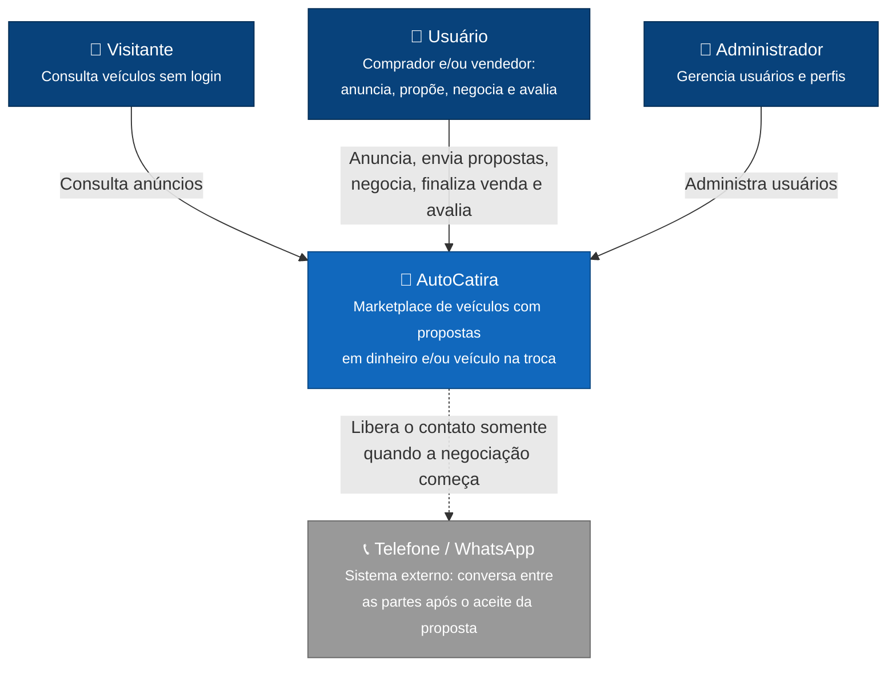
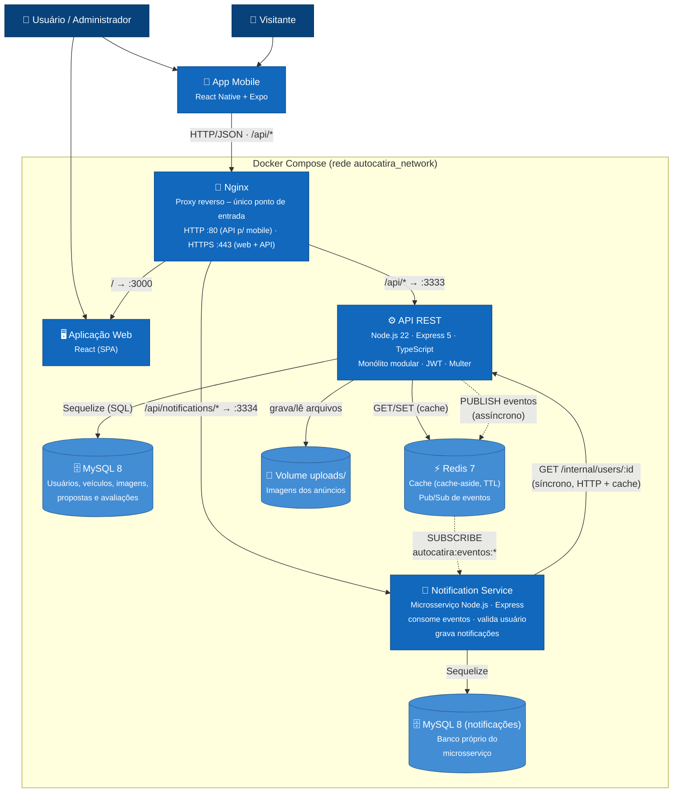

# Documentação Arquitetural – Modelo C4

O AutoCatira é documentado com os dois primeiros níveis do modelo C4: **Contexto**, que mostra o sistema e quem interage com ele, e **Containers**, que mostra as aplicações e os serviços que compõem o sistema.

## Nível 1 – Diagrama de Contexto



| Elemento | Tipo | Descrição |
|---|---|---|
| Visitante | Pessoa | Navega pelos anúncios sem autenticação. Não vê dados pessoais dos anunciantes. |
| Usuário | Pessoa | Mesma conta atua como **vendedor** (anuncia, recebe e decide propostas, finaliza a venda) e como **comprador** (envia propostas, oferece seu veículo na troca, acompanha negociações). |
| Administrador | Pessoa | Usuário com perfil `ADMIN`: lista usuários e altera perfis. |
| AutoCatira | Sistema | Estrutura o ciclo completo: anúncio → proposta → negociação → venda → avaliação. |
| Telefone / WhatsApp | Sistema externo | Canal de conversa entre as partes. O AutoCatira só revela o telefone quando a proposta entra em negociação. |

## Nível 2 – Diagrama de Containers



| Container | Tecnologia | Responsabilidade |
|---|---|---|
| App Mobile | React Native + Expo | Cliente principal. Guarda o JWT no SecureStore e encerra a sessão ao receber 401. |
| Aplicação Web | React | Cliente web da versão anterior, mantido como segundo consumidor da mesma API. |
| Nginx | nginx:alpine | Única porta exposta (80/443). Faz proxy reverso para a API e o web, aplica cabeçalhos de segurança e timeouts. |
| API REST | Node.js 22, Express 5, TypeScript, Sequelize | Regras de negócio, autenticação JWT, upload com Multer, cache, eventos, logs estruturados, `/health` e `/docs` (Swagger). |
| MySQL 8 | mysql:8.0 | Persistência relacional. Possui healthcheck; a API só sobe quando ele está saudável. |
| Redis 7 | redis:7-alpine | Cache distribuído da listagem/detalhe de veículos e barramento de eventos (Pub/Sub). Limite de 128 MB com política LRU. |
| Volume `uploads/` | Volume Docker | Imagens enviadas, com nomes únicos (UUID). |
| **Notification Service** | Node.js 22, Express 5, TypeScript, Sequelize | **Microsserviço** do contexto de Notificações. Consome os eventos da API via Redis (assíncrono), valida o destinatário na API principal por HTTP com cache Redis (síncrono), grava as notificações e expõe `/api/notifications/me`. Sobe e funciona independentemente da API. |
| MySQL de notificações | mysql:8.0 | **Banco próprio do microsserviço** (*database per service*): tabela `notifications` com status `PENDENTE`, `ENTREGUE` ou `DESCARTADA`. |

### Organização interna da API (monólito modular)

```
backend/src/
├── modules/negotiation/   ← Bounded Context de Negociação
│   ├── dtos/              ← validação de entrada
│   ├── repositories/      ← acesso ao banco (único ponto que conhece o ORM)
│   ├── *.service.ts       ← casos de uso e regras de negócio
│   └── *.controller.ts    ← HTTP
├── controllers/           ← Catálogo (veículos/imagens), Identidade (auth/usuários/admin), Reputação (avaliações)
├── cache/                 ← cache-aside com Redis + circuit breaker
├── events/                ← publicação de eventos de domínio (Redis Pub/Sub)
├── middlewares/           ← autenticação, autorização, logs de requisição, erros
├── models/                ← entidades Sequelize
├── routes/                ← rotas HTTP, /health e /docs
└── utils/                 ← logger, AppError, circuit breaker, contexto da requisição
```

### Organização interna do microsserviço de notificações

```
notification-service/src/
├── domain/          ← regra de negócio: qual notificação cada evento gera
├── services/        ← casos de uso: processar evento, entregar, reconciliar pendentes
├── repositories/    ← acesso ao banco próprio (tabela notifications)
├── clients/         ← comunicação síncrona com a API principal (HTTP + cache + retry)
├── consumers/       ← comunicação assíncrona: assinatura dos eventos no Redis
├── http/            ← rotas /health, /me, /:id/read
└── config/          ← banco, Redis e variáveis de ambiente
```
