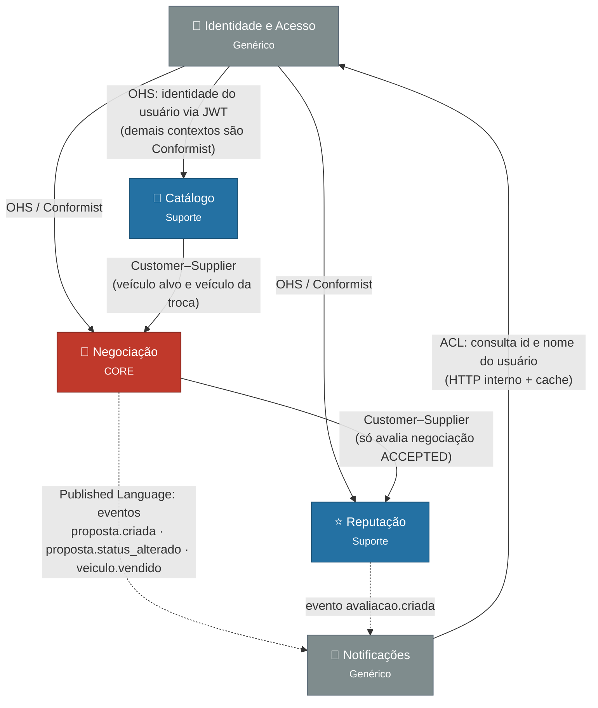
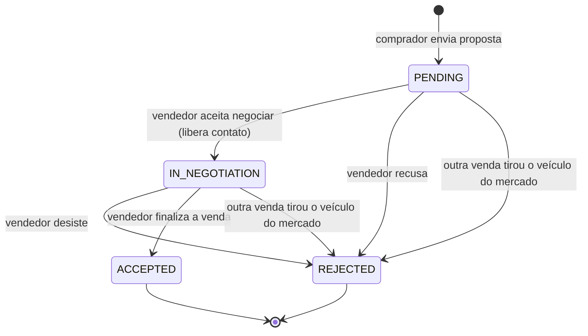

# Estilos Arquiteturais e DDD (Domain-Driven Design)

## 1. Domínio e subdomínios

O domínio do AutoCatira é a **negociação de veículos usados com possibilidade de troca**.

| Subdomínio | Tipo | Por quê |
|---|---|---|
| **Negociação** (propostas, troca, venda) | **Núcleo (Core)** | É o diferencial do produto: proposta em dinheiro **e/ou com veículo na troca**, controle de estados e venda "tudo ou nada". |
| **Catálogo** (anúncios e imagens) | Suporte | Necessário para existir negociação, mas é comum a qualquer marketplace. |
| **Reputação** (avaliações) | Suporte | Aumenta a confiança entre as partes após a venda. |
| **Identidade e Acesso** (cadastro, login, perfis) | Genérico | Problema resolvido no mercado (JWT, hash de senha, perfis USER/ADMIN). |
| **Notificações** | Genérico | Reage a eventos para avisar as partes. |

## 2. Linguagem ubíqua

| Termo | Significado no AutoCatira |
|---|---|
| **Anúncio / Veículo** | Veículo publicado por um usuário, com status `available` ou `sold`. |
| **Proposta** | Oferta do comprador por um anúncio: valor em dinheiro e/ou um veículo dele na troca. |
| **Troca** | Veículo do comprador oferecido como parte do pagamento. |
| **Negociação** | Proposta aceita pelo vendedor para conversa (`IN_NEGOTIATION`); os contatos são liberados. |
| **Venda** | Conclusão da negociação: proposta `ACCEPTED`, veículos `sold`, demais propostas `REJECTED`. |
| **Avaliação** | Nota de 1 a 5 que comprador e vendedor dão um ao outro após a venda. |

## 3. Bounded Contexts e onde estão no código

| Bounded Context | Responsabilidade | Código |
|---|---|---|
| **Negociação** | Propostas, decisão do vendedor, finalização da venda | `backend/src/modules/negotiation/` (DTOs, repositories, `ProposalService`, `SaleService`, controller, rotas) |
| **Catálogo** | CRUD de anúncios, imagens (Multer), listagem com cache | `controllers/VehicleController.ts`, `controllers/VehicleImageController.ts`, `cache/` |
| **Identidade e Acesso** | Cadastro, login JWT, perfis, administração | `controllers/AuthController.ts`, `UserController.ts`, `AdminController.ts`, `middlewares/` |
| **Reputação** | Avaliações após a venda | `controllers/ReviewController.ts` |
| **Notificações** | Avisar as partes sobre os eventos da negociação | **Microsserviço** `notification-service/` (banco próprio; domínio, services, repositories, consumidor de eventos) |

## 4. Context Map

- **Upstream / Downstream:** Catálogo é *upstream* de Negociação. A Negociação depende do veículo (dono e status), mas o Catálogo não conhece propostas.
- **Open Host Service (OHS):** Identidade expõe o usuário autenticado de forma padronizada (`userId` e `userRole` no request).
- **Published Language:** a Negociação publica eventos com formato fixo (`EventEnvelope`: `eventId`, `event`, `occurredAt`, `requestId`, `data`), consumidos sem acoplamento pelo **microsserviço de Notificações**.
- **Anticorruption Layer (ACL):** o microsserviço não lê o banco da API. Ele consulta apenas `id` e `nome` do usuário por uma rota interna (`clients/userClient.ts`), traduzindo para o seu próprio modelo.

## 5. Contexto detalhado: Negociação

### Entities
| Entity | Identidade | Ciclo de vida |
|---|---|---|
| **Proposta** (`Proposal`) | `id` (UUID) | `PENDING → IN_NEGOTIATION → ACCEPTED`, ou `REJECTED` |
| **Veículo** (referência ao Catálogo) | `id` (UUID) | `available → sold` |

### Value Objects
| Value Object | Regras (invariantes) | Implementação |
|---|---|---|
| **Valor da oferta** (`cashOffer`) | Sem troca: > 0. Com troca: ≥ 0 (padrão 0). Numérico. | `toCreateProposalDTO` + `ProposalService.create` |
| **Status da proposta** | Só aceita as transições válidas do diagrama abaixo | `ProposalStatus` + validação em `ProposalService.updateStatus` |
| **Decisão do vendedor** | Apenas `IN_NEGOTIATION` ou `REJECTED` | `UpdateProposalStatusDTO` |
| **Contato do comprador** | `{ name, phone }`, liberado só com a negociação iniciada | `BuyerContactDTO` |
| **Mensagem** | Opcional, até 500 caracteres | `CreateProposalDTO` |

### Aggregate: Proposta (raiz)
A **Proposta** é a raiz do agregado: qualquer mudança de estado passa por ela, e as invariantes são garantidas no `ProposalService`:

1. O comprador **não pode** propor no próprio veículo.
2. O veículo alvo precisa estar `available`.
3. O veículo da troca precisa **pertencer ao comprador** e estar `available`.
4. Um comprador só pode ter **uma proposta ativa** (PENDING ou IN_NEGOTIATION) por veículo.
5. Só o **dono do veículo alvo** decide a proposta.
6. As transições de status seguem o diagrama:

### Camadas do módulo
- **DTOs:** validam a entrada.
- **Services:** casos de uso e invariantes do agregado.
- **Repositories:** únicos que acessam o banco, por exemplo `proposalRepository.rejectActiveInvolvingVehicles`.
- **Controller:** HTTP.

O service não conhece o ORM. Trocar o banco afetaria apenas os repositories.

### Domain Service: Finalizar Venda (`SaleService`)
A venda envolve **mais de um agregado** (a proposta vencedora, os veículos e as outras propostas), por isso fica num serviço de domínio que executa tudo **em uma transação**:

1. Confere que quem finaliza é o dono e que existe negociação ativa com o comprador.
2. Marca o veículo alvo como `sold` e a proposta como `ACCEPTED`.
3. Se houver troca, marca o veículo oferecido como `sold`.
4. Rejeita **todas** as outras propostas ativas que tenham qualquer um desses veículos como alvo ou como troca.
5. Depois do commit: invalida o cache e publica o evento `veiculo.vendido`.

### Domain Events
Os eventos são consumidos pelo **microsserviço de Notificações**, que gera e grava as notificações em seu próprio banco:

| Evento | Quando | Reação (notification-service) |
|---|---|---|
| `proposta.criada` | Comprador envia proposta | Notifica o vendedor |
| `proposta.status_alterado` | Vendedor aceita ou recusa | Notifica o comprador |
| `veiculo.vendido` | Venda finalizada (após o commit) | Avisa comprador e vendedor e convida a avaliar |
| `avaliacao.criada` | Usuário avalia | Notifica o avaliado |
