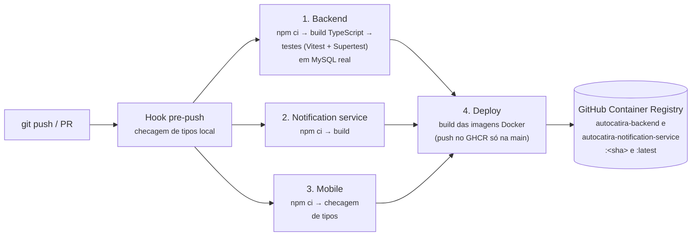

# Entrega Contínua – Pipeline, Deploy e Runbook

## 1. Pipeline CI/CD

**Arquivo:** [`.github/workflows/ci.yml`](../../.github/workflows/ci.yml), no GitHub Actions.
**Quando roda:** em todo push nas branches `main`, `dev`, `feat/**` e `fix/**`, e em pull requests para `main` e `dev`.



| Etapa | O que valida |
|---|---|
| **Build** | O TypeScript do backend e do microsserviço compila (`npm run build`), e o do mobile não tem erros de tipo. |
| **Test** | Testes de cadastro, segurança (acesso a recursos de outro usuário), fluxo de negociação, **venda com troca**, propostas duplicadas e para o próprio veículo, rodando contra um **MySQL 8 de verdade** (service container). |
| **Deploy** | As imagens Docker de produção do backend e do microsserviço são construídas a cada push. Na `main`, são publicadas no GHCR com a **tag do commit** e `latest`. |

Padrões de qualidade complementares:
- **Commits** seguem o Conventional Commits, verificado pelo commitlint (husky `commit-msg`).
- **Lint** do front-end roda no `pre-commit`.
- **Hook `pre-push`** checa os tipos do backend antes de enviar.

## 2. Estratégia de deploy: rollback simples

**Escolha:** deploy com **substituição do container** e **rollback simples por tag de imagem**.

1. O CI publica `ghcr.io/<usuario>/autocatira-backend:<sha-do-commit>` a cada merge na `main`.
2. Deploy: `docker compose pull backend && docker compose up -d backend`. O healthcheck só marca o backend como saudável quando `/health` responde 200.
3. **Rollback:** se o healthcheck falhar ou os logs mostrarem erros, volta-se para a tag do commit anterior:
   ```bash
   # no servidor, apontando a imagem para a versão anterior
   docker compose up -d backend   # com image: ghcr.io/<usuario>/autocatira-backend:<sha-anterior>
   ```
   Versões de entrega também ficam marcadas com **tags Git** (`v2.0.0`, `v3.0.0`).

**Por que não blue/green:** blue/green exige duas pilhas completas e um balanceador alternando o tráfego. Para um único servidor e o volume atual, o custo não compensa. O rollback por tag dá uma recuperação em poucos minutos com uma fração da complexidade. Os dados são compatíveis entre versões, porque o banco só recebe mudanças aditivas.

## 3. Runbook de incidentes

Antes de qualquer ação: `docker compose ps` e `curl http://localhost/api/health`.

### 🔴 API fora do ar (app mostra "Não foi possível carregar…")
- **Sintomas:** erro em todas as telas; `/api/health` não responde ou retorna 502 pelo Nginx.
- **Diagnóstico:**
  - `docker compose ps`: o backend está `unhealthy`, reiniciando ou parado?
  - `docker compose logs --tail 100 backend`: procurar `level":"error"`.
- **Ação:**
  1. Se for erro de inicialização ou de código recente: **rollback** para a imagem anterior.
  2. Se o container estiver travado: `docker compose restart backend`.
  3. Confirmar com `/api/health`.

### 🔴 MySQL indisponível
- **Sintomas:** `/api/health` → `503` com `"mysql":"down"`; logs com `banco.falha_conexao`.
- **Diagnóstico:** `docker compose ps db` e `docker compose logs --tail 50 db` (disco cheio? senha alterada?).
- **Ação:**
  1. `docker compose restart db`. A API reconecta sozinha (retry com backoff).
  2. Se o volume estiver corrompido, restaurar o backup. **Nunca** usar `docker compose down -v` em produção, porque apaga os dados.

### 🟡 Redis indisponível (sistema degradado)
- **Sintomas:** `/api/health` → `"status":"degraded"`, `"redis":"down"`; logs `cache.bypass` e `circuit_breaker.estado → OPEN`. **O sistema continua funcionando**, só mais lento.
- **Ação:**
  1. `docker compose restart redis`. O cliente reconecta automaticamente e o circuito fecha sozinho.
  2. Não há perda de dados, porque o Redis guarda apenas cache.

### 🟠 Erro 500 numa operação específica
- **Sintomas:** usuário relata erro numa ação (ex.: abrir negociações).
- **Diagnóstico:**
  1. Pegar o `X-Request-Id` da resposta, ou o horário do erro.
  2. `docker compose logs backend | findstr <requestId>` e procurar `http.erro_interno`, que contém o erro e o stack.
- **Ação:** corrigir, abrir um card **Bug** no Jira, commit `fix:` e deploy pelo pipeline.
- **Caso real (12/11):** `Not unique table/alias 'offeredVehicle->images'` ao listar negociações. Foi identificado pelo log em minutos e corrigido no commit `fix: corrige includes reutilizados…`.

### 🟡 Microsserviço de notificações fora do ar
- **Sintomas:** `/api/notifications/health` não responde; o app continua funcionando, mas sem novas notificações.
- **Diagnóstico:**
  - `docker compose ps notification-service notification-db`;
  - `docker compose logs --tail 100 notification-service`.
- **Ação:**
  1. `docker compose restart notification-service`, ou `notification-db` se for o banco.
  2. **Atenção:** eventos publicados enquanto o serviço estava fora são perdidos (limitação do Pub/Sub, ver ADR-007).

### 🟡 Notificações presas em PENDENTE
- **Sintomas:** `/api/notifications/health` mostra `PENDENTE` crescendo e `apiPrincipal: down`; logs `notificacao.pendente`.
- **Ação:** restabelecer a API principal (ver "API fora do ar"). A reconciliação entrega as pendentes em até 30 s, sem ação manual.

### 🟠 App mobile não conecta à API
- **Sintomas:** "Não foi possível carregar os veículos", mas `http://localhost/api/health` funciona no computador.
- **Diagnóstico:**
  1. `EXPO_PUBLIC_API_URL` em `mobile/.env.local` deve usar o **IP da rede Wi-Fi** (via `ipconfig`), não o IP de adaptador virtual (ex.: `192.168.56.1`).
  2. Testar `http://<IP>/api/health` **no navegador do celular**.
- **Ação:**
  1. Corrigir o IP e reiniciar o Expo com `npx expo start -c`.
  2. Se o navegador do celular não abrir, liberar a porta 80 no firewall do Windows.

### 🟠 Upload de imagens falhando
- **Sintomas:** `413` ou `400` no upload; logs `upload.rejeitado`.
- **Ação:**
  - Para `413`: o arquivo passa de 5 MB e deve ser reduzido.
  - Para `400`: o formato não é JPG, PNG ou WEBP.
  - Se for erro 5xx: verificar o espaço em disco do volume `backend/uploads`.
